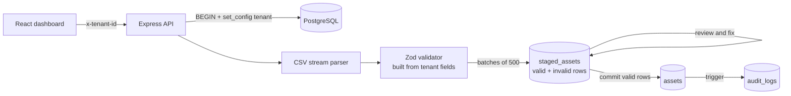

# Multi-Tenant ETL & Data Ingestion Platform

A multi-tenant asset management SaaS. Each tenant defines its own asset schema, imports large CSV files through a streaming pipeline, reviews and fixes invalid rows in a staging area, and commits clean data. Tenant isolation is enforced by PostgreSQL Row-Level Security, not by application code alone.

## Highlights

- **Database-enforced multi-tenancy:** forced Row-Level Security on every tenant table, with a transaction-scoped tenant context and a non-superuser application role.
- **Streaming CSV ingestion:** files are parsed as a stream and inserted in batches of 500 rows, so memory stays flat as files grow.
- **Per-tenant dynamic validation:** Zod validators are generated at runtime from each tenant's field definitions.
- **Staging and review:** invalid rows are stored with per-row errors, can be corrected, and are revalidated before commit.
- **Audit trail:** a PostgreSQL trigger snapshots every insert, update and delete on assets.

## Architecture



Every request runs inside a transaction that first calls `set_config('app.current_tenant', <tenant id>, true)`. The RLS policies compare each row's `tenant_id` with that setting, so a query can only see or write its own tenant's rows. The setting is cleared when the transaction ends, and a query without it fails instead of returning every tenant's data.

## Tenant isolation

| Table | Policy |
|---|---|
| `assets` | Read and write only the current tenant's rows |
| `staged_assets` | Read and write only the current tenant's rows |
| `asset_fields` | Read and write only the current tenant's schema |
| `audit_logs` | Read entries only for the current tenant's assets; inserts come from the trigger |

All four tables use `FORCE ROW LEVEL SECURITY`, and the application connects as a role that is not a superuser, has no `BYPASSRLS`, and does not own the tables.

Verified directly in SQL as the application role: while acting as tenant A, reading, updating, deleting, inserting or moving rows into tenant B returns zero rows or is rejected with `new row violates row-level security policy`.

## Performance

Measured on a local PostgreSQL 18 instance with generated CSVs containing 5% invalid rows.

| CSV rows | File size | Import time | Throughput |
|---|---|---|---|
| 100,000 | 4.5 MB | 9.0 s | ~11,000 rows/s |
| 500,000 | 23 MB | 51.7 s | ~9,700 rows/s |
| 1,000,000 | 46 MB | 113 s | ~8,800 rows/s |

- Peak server memory went from 365 MB at 100,000 rows to 401 MB at 1,000,000 rows: a 10x larger file used about 10% more memory.
- All 50,000 invalid rows in the 1,000,000-row file were routed to staging with their errors.
- Adding `tenant_id` indexes cut loading one tenant's invalid rows (out of 1.6M staged rows) from 1,487 ms to 2.9 ms.

## Tech stack

- **Backend:** Node.js, Express 5, TypeScript, `pg`, Zod, `csv-parser`, Multer
- **Database:** PostgreSQL (Row-Level Security, triggers, JSONB)
- **Frontend:** React, TypeScript, Vite, Tailwind CSS

## Getting started

### 1. Database

Create the database and an application role as the `postgres` user:

```sql
CREATE DATABASE asset_manager;
CREATE ROLE app_user LOGIN PASSWORD 'change_me';
```

Apply the schema as `postgres`:

```powershell
psql -U postgres -d asset_manager -f backend/sql/001_schema.sql
psql -U postgres -d asset_manager -f backend/sql/002_tenant_indexes_and_field_isolation.sql
```

Grant the application role access to the tables (it must not own them):

```sql
GRANT SELECT, INSERT, UPDATE, DELETE ON ALL TABLES IN SCHEMA public TO app_user;
```

### 2. Backend

```powershell
cd backend
copy .env.example .env
npm install
npm run dev
```

The API runs on `http://localhost:3000`.

### 3. Frontend

```powershell
cd frontend
npm install
npm run dev
```

Open the URL Vite prints (usually `http://localhost:5173`).

## API

All routes except `/tenants` require an `x-tenant-id` header.

| Method | Endpoint | Purpose |
|---|---|---|
| POST | `/tenants` | Create a tenant |
| GET | `/tenants` | List tenants |
| POST | `/fields` | Define the tenant's asset schema |
| GET | `/fields` | Get the tenant's asset schema |
| POST | `/upload` | Stream a CSV into staging (`multipart/form-data`, field `file`) |
| GET | `/staged/invalid` | List invalid staged rows with their errors |
| PATCH | `/staged/:id` | Correct a staged row and revalidate it |
| POST | `/staged/commit` | Move valid staged rows into `assets` |
| GET | `/assets` | List the tenant's assets |
| POST | `/assets/manual` | Create an asset directly |
| PATCH | `/assets/:id` | Update an asset |
| DELETE | `/assets/:id` | Delete an asset |
| POST | `/seed-data` | Insert sample staged data |

## Limitations and next steps

- The tenant is taken from the `x-tenant-id` header. A production version would derive it from an authenticated session or JWT, so a client cannot choose its tenant.
- An upload runs as a single transaction, so a failure rolls back the whole file. Very large imports could commit per batch with resumable progress.
- Add automated integration tests for the isolation checks above.
